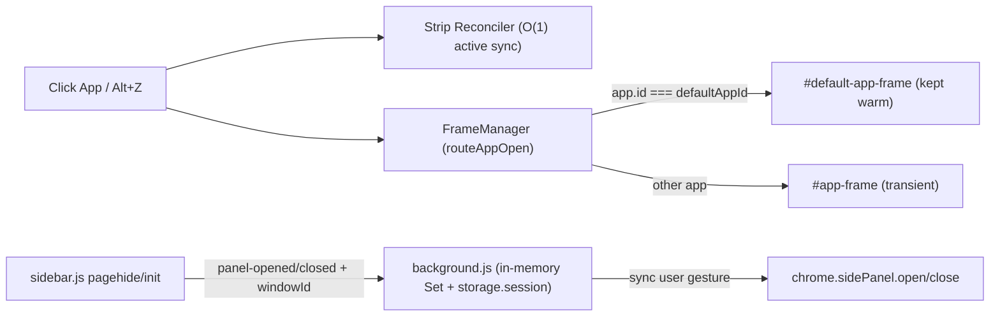

# Architecture & Technical Design

## 1. Overview & Invariants
- **Overview**:
  1. **M3 Theme (`sidebar.css`, `sidebar.js`)**: Pure CSS Material Design 3 token system (`surface` hierarchy, `primary`/`error`/`outline` roles, state-layer opacities, shape/typography/motion tokens, `prefers-color-scheme: light | dark`, `prefers-reduced-motion`), plus `.toast--info|success|error` classes.
  2. **Warm Default + Transient Frame (`frame-manager.js`, `sidebar.html`, `sidebar.js`)**: Two-slot iframe architecture (`#default-app-frame` for `defaultAppId`, `#app-frame` for all other apps) with pure slot routing & invalidation logic.
  3. **In-Place Strip Reconciliation (`strip-reconciler.js`, `sidebar.js`)**: Keyed DOM reconciliation by `app.id` + O(1) `.active`/`.edit-mode` sync + dynamic `dataset.idx` drag-and-drop.
  4. **SW Panel State (`background.js`, `sidebar.js`)**: `openWindows` mirrored to `chrome.storage.session` (in-memory `Set` hydrated at SW top-level/startup so `chrome.sidePanel.open({ windowId })` stays synchronous inside user gesture) + `windowId` on `pagehide` `panel-closed` + `chrome.windows.onRemoved` pruning.
- **Invariants**:
  1. At most one non-active iframe (`#default-app-frame`) ever stays warm in memory; when `defaultAppId` is `null`, zero iframes stay warm after `closePanel()`.
  2. `openApp()` / `closePanel()` / `toggleEditMode()` never destroy or recreate existing `#app-icons` nodes.
  3. `chrome.sidePanel.open({ windowId })` is never preceded by an `await` inside `chrome.action.onClicked` or `chrome.commands.onCommand`.
  4. `openWindows` tracks native side-panel open/close (`init` + `pagehide`), not internal `#content-panel` visibility (`closePanel()`).

## 2. Domain Models, State & Interface Contracts

### Pure Core: `frame-manager.js` (`OmniBarFrameManager`)
```js
// Pure, zero-DOM UMD module
createFrameState()
// -> { default: { appId: null, url: '', status: 'idle' }, transient: { appId: null, url: '', status: 'idle' } }

routeAppOpen(state, app, defaultAppId)
// -> { slot: 'default' | 'transient', shouldLoad: boolean, nextState }

reconcileFramesOnChange(state, apps, nextDefaultAppId)
// -> { clearDefault: boolean, clearTransient: boolean, nextState }
```

### Pure Core: `strip-reconciler.js` (`OmniBarStripReconciler`)
```js
// Pure, zero-DOM UMD module
diffStripApps(prevApps, nextApps)
// -> { orderedIds: string[], toCreate: App[], toUpdate: App[], toRemoveIds: string[] }
```

### SW State: `background.js`
- `const openWindows = new Set();` hydrated eagerly on SW load via `chrome.storage.session.get('openWindows')` (without blocking listener registration) and persisted on every add/delete via `chrome.storage.session.set({ openWindows: [...openWindows] })`.
- `chrome.windows.onRemoved.addListener(wid => ...)` prunes closed windows.

## 3. Architecture Diagram & Data Flow



## 4. Boundary Rules & Budgets
- **Pure Core vs. I/O Shell**:
  - `frame-manager.js` and `strip-reconciler.js` have zero DOM, timer, or `chrome.*` calls.
  - `sidebar.js` owns DOM elements, `loadTimer` map (`{ default: null, transient: null }`), `iframe.src` writes, and `chrome.storage.local` / `chrome.runtime.sendMessage`.
- **Concurrency, Latency & Resource Budgets**:
  - `NFR-M3-1`: Pure CSS tokens, zero build/npm deps.
  - `NFR-FRAME-1`: Max 2 iframes total; max 1 warm when `closePanel()` runs.
  - `NFR-STRIP-1`: O(1) active/edit toggle, zero favicon reloads on switch.
  - `NFR-SW-1`: Uses `chrome.storage.session` under existing `storage` permission.

## 5. Testing Strategy
1. **BDD Scenarios**: Map `REQ-M3-*`, `REQ-FRAME-*`, `REQ-STRIP-*`, `REQ-SW-*`, and `REQ-DEFAULT-3` scenarios to `node --test` suites.
2. **Unit Tests (>= 95% line & branch coverage)**: Full branch coverage on `frame-manager.js` and `strip-reconciler.js` plus `node:vm` integration tests for `sidebar.js` and `background.js`.
3. **Mutation Testing (>= 95% kill score)**: Verify all mutants on `frame-manager.js` and `strip-reconciler.js` are killed.

## Review Gate
- [x] **Gate 2 Approval**: Architecture & design reviewed and approved by human before task breakdown.
