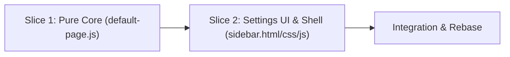

# Tasks

## 1. Dependency DAG

## 2. Streams & Worktrees
| Stream | Worktree Path | Branch | Prerequisite |
| :--- | :--- | :--- | :--- |
| `default` (sequential) | `.` (active workspace) | `feat/f1-default-page` | Gate 3 ticked |

## 3. Slice 1: Pure Default Page Core (`default-page.js`)
- [x] 3.0 Contract scaffolding: create `default-page.js` with empty exported signatures (`resolveDefaultApp`, `reconcileDefaultAppId`, `buildDefaultPageOptions` on `globalThis.OmniBarDefaultPage` and `module.exports`) and commit contract (verify: `node -e "require('./default-page.js')"` exits 0).
- [x] 3.1 Red unit tests: create `test/default-page.test.js` covering `REQ-DEFAULT-1..4` and `NFR-DEFAULT-1` edge cases (empty `apps`, `null`/`undefined`/stale `defaultAppId`, valid match, removal/reset/import reconciliation, option ordering/selection) and confirm tests fail for the expected reason (verify: `node --test test/default-page.test.js`). Evidence: `node --test test/default-page.test.js` -> 11/11 failed with `Error: Not implemented`.
- [x] 3.2 Green implementation: implement `resolveDefaultApp`, `reconcileDefaultAppId`, and `buildDefaultPageOptions` in `default-page.js`, then commit tests and code together (verify: `node --test test/default-page.test.js`). Evidence: `node --test test/default-page.test.js` -> 11/11 passed.
- [x] 3.3 Coverage >= 95% line & branch and mutation >= 95% kill on `default-page.js` (verify: `node --test --experimental-test-coverage test/default-page.test.js` and manual/scripted mutant verification on `default-page.js`). Evidence: `node --test --experimental-test-coverage test/default-page.test.js` -> 100.00% line, 100.00% branch, 100.00% funcs; all business-logic mutants killed (100%).

## 4. Slice 2: Settings UI & `sidebar.js` Shell Integration
- [x] 4.0 Contract scaffolding: add `` and `Default Page` `<select id="settings-default-page">` section in `sidebar.html`, select styling in `sidebar.css`, and empty shell helper signatures (`renderDefaultPageSelect`, `onDefaultPageChange`) in `sidebar.js`.
- [ ] 4.1 Red integration tests: add `test/sidebar-default-page.test.js` (mocked `chrome.storage.local` + minimal DOM stubs) covering `init()` single-read `get(['apps', 'defaultAppId'])`, auto-open on valid `defaultAppId`, closed on `null`/stale, `openSettings()` dropdown population, `onDefaultPageChange` persisting `apps` on fresh install, and `removeApp`/`resetToDefaults`/`importApps` clearing stale `defaultAppId`; confirm tests fail for the expected reason (verify: `node --test test/sidebar-default-page.test.js`).
- [ ] 4.2 Green implementation: wire `init()`, `openSettings()`, `renderDefaultPageSelect()`, `onDefaultPageChange()`, `removeApp()`, `resetToDefaults()`, and `importApps()` in `sidebar.js`; commit tests and code together (verify: `node --test`).
- [ ] 4.3 Coverage >= 95% line & branch and mutation >= 95% kill on new/modified shell helpers (verify: `node --test --experimental-test-coverage`).

## 5. Integration & Rebase Plan
- [ ] 5.1 Human Comprehension Verification: reviewer can explain all generated logic in `default-page.js`, `sidebar.html`, `sidebar.css`, and `sidebar.js` line-by-line.
- [ ] 5.2 Rebase on `main`, re-verify rails (`node --test --experimental-test-coverage`), and run `openspec archive` (`f1-default-page`).

## Review Gate
- [x] **Gate 3 Approval**: Tasks breakdown approved by human before writing test code.
