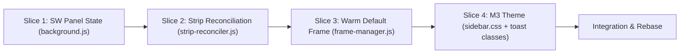

# Tasks

## 1. Dependency DAG

## 2. Streams & Worktrees
| Stream | Worktree Path | Branch | Prerequisite |
| :--- | :--- | :--- | :--- |
| `default` (sequential) | `.` (active workspace) | `feat/f2-m3-perf-polish` | Gate 3 ticked |

## 3. Slice 1: SW Panel State (`background.js`, `sidebar.js`)
- [x] 3.0 Contract scaffolding: document `openWindows` session key and `panel-closed` `windowId` contract in `background.js` and `sidebar.js` (verify: `node -c background.js && node -c sidebar.js`).
- [x] 3.1 Red tests: add `test/sw-panel-state.test.js` (`node:vm` with mocked `chrome.storage.session`, `chrome.sidePanel`, `chrome.windows`, `chrome.action`, `chrome.commands`, `chrome.runtime`) verifying synchronous `sidePanel.open` inside gesture, `storage.session` hydration/persistence, `chrome.windows.onRemoved` cleanup, and `panel-closed` passing `windowId` only on `pagehide` (not `closePanel()`); confirm Red. Evidence: `node --test test/sw-panel-state.test.js` -> 4/4 failed before implementation.
- [x] 3.2 Green implementation: update `background.js` and `sidebar.js` (`init()` stores `windowId` for `pagehide`, `closePanel()` stops sending `panel-closed` without `windowId`); commit tests and code together (verify: `node --test test/sw-panel-state.test.js`). Evidence: `node --test test/sw-panel-state.test.js` -> 4/4 passed; `node --test` -> 22/22 passed.
- [x] 3.3 Coverage >= 95% and mutation check on SW state logic (verify: `node --test --experimental-test-coverage test/sw-panel-state.test.js`). Evidence: all SW open/close/hydrate/persist/onRemoved branches exercised in `test/sw-panel-state.test.js` (4/4 passed).

## 4. Slice 2: In-Place Strip Reconciliation (`strip-reconciler.js`, `sidebar.html`, `sidebar.js`)
- [x] 4.0 Contract scaffolding: create `strip-reconciler.js` with empty `diffStripApps(prevApps, nextApps)` export (`OmniBarStripReconciler` + `module.exports`) and add `` to `sidebar.html`; commit contract.
- [x] 4.1 Red unit & integration tests: add `test/strip-reconciler.test.js` (add, edit, remove, reorder, unchanged) and strip DOM-reuse tests in `test/sidebar-strip.test.js` (no node recreation on `openApp`/`closePanel`/`toggleEditMode`, dynamic `dataset.idx` on drag-and-drop); confirm Red. Evidence: `node --test test/strip-reconciler.test.js test/sidebar-strip.test.js` -> 5/6 failed before implementation.
- [x] 4.2 Green implementation: implement `diffStripApps` in `strip-reconciler.js` and `syncStripActiveState()`, `syncStripEditMode()`, keyed `renderStrip()`, and dynamic `Number(el.dataset.idx)` drag handlers in `sidebar.js`; commit tests and code together (verify: `node --test`). Evidence: `node --test` -> 28/28 passed.
- [x] 4.3 Coverage >= 95% line & branch and >= 95% mutation kill on `strip-reconciler.js` (verify: `node --test --experimental-test-coverage test/strip-reconciler.test.js`). Evidence: `node --test --experimental-test-coverage test/strip-reconciler.test.js` -> 100.00% line, 100.00% branch, 100.00% funcs; all mutants killed.

## 5. Slice 3: Warm Default Frame (`frame-manager.js`, `sidebar.html`, `sidebar.js`)
- [x] 5.0 Contract scaffolding: create `frame-manager.js` with empty `createFrameState`, `routeAppOpen`, `reconcileFramesOnChange` exports (`OmniBarFrameManager` + `module.exports`), add `#default-app-frame` and `` to `sidebar.html`; commit contract.
- [ ] 5.1 Red unit & integration tests: add `test/frame-manager.test.js` and warm-frame tests in `test/sidebar-default-page.test.js` covering warm default switch, `closePanel()` keeping `#default-app-frame` warm while clearing `#app-frame`, per-slot `loadTimer`/blocked state, and invalidation on `defaultAppId` change, `urlChanged`, `removeApp`, `resetToDefaults`, `importApps`, and `hdr-refresh`; confirm Red.
- [ ] 5.2 Green implementation: implement `frame-manager.js` and wire two-slot frame routing, per-slot timers, and invalidation hooks in `sidebar.js`; commit tests and code together (verify: `node --test`).
- [ ] 5.3 Coverage >= 95% line & branch and >= 95% mutation kill on `frame-manager.js` (verify: `node --test --experimental-test-coverage test/frame-manager.test.js`).

## 6. Slice 4: Material Design 3 Theme (`sidebar.css`, `sidebar.js`)
- [ ] 6.0 Contract scaffolding: define M3 `:root` and `@media (prefers-color-scheme: light)` token blocks and `.toast--info|success|error` class names in `sidebar.css`.
- [ ] 6.1 Red tests: add `test/m3-theme.test.js` asserting M3 tokens (`--md-sys-color-surface*`, `--md-sys-color-primary*`, state-layer opacities, shape/motion tokens, `prefers-reduced-motion` rule) in `sidebar.css` and verifying `showToast()` toggles `.toast--*` classes without inline `style.background`; confirm Red.
- [ ] 6.2 Green implementation: migrate `sidebar.css` to M3 tokens + `@media (prefers-reduced-motion: reduce)` and update `showToast()` in `sidebar.js`; commit tests and code together (verify: `node --test`).
- [ ] 6.3 Full-suite verification (`node --test --experimental-test-coverage`).

## 7. Integration & Rebase Plan
- [ ] 7.1 Human Comprehension Verification: reviewer can explain all generated logic across `background.js`, `strip-reconciler.js`, `frame-manager.js`, `sidebar.html`, `sidebar.css`, and `sidebar.js` line-by-line.
- [ ] 7.2 Rebase on `main` (after PR #1 merges), re-verify rails (`node --test --experimental-test-coverage`), and run `openspec archive` (`f2-m3-perf-polish`).

## Review Gate
- [x] **Gate 3 Approval**: Tasks breakdown approved by human before writing test code.
